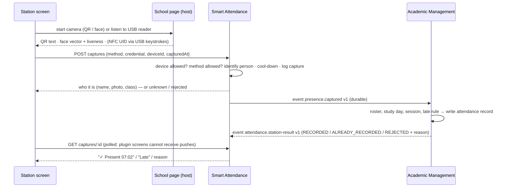

# Smart Attendance plugin: architecture plan

Started: 2026-11-20 · Status: **Phases 0–3 built** (Smart Attendance 0.2.0, Academic Management 0.34.0, school core branch feat/station-bridges; local marketplace). Open: §15 decisions 3–6, crypto.encrypt (C3), vendor-specific terminal adapters. Faces use open-source models (decided 2026-11-20): MediaPipe (Apache-2.0) for detection, landmarks and liveness, and dlib's ResNet (CC0 weights, MIT conversion) for recognition. See face-recognition-model-plan.md for the training-data caveat and the pilot needed first.
Scope: a new plugin, `wattanam.smart-attendance`, plus small additions to Academic Management and the school core.

## 1. Summary

Smart Attendance turns any tablet, phone, PC or attendance terminal into an **attendance station**. A station identifies students and staff in one of three ways:

- by **QR code**;
- by **NFC card**;
- by **face**.

Each identification is handed to Academic Management, which stays the **single owner of attendance records**. Academic Management already keeps the sessions, late rules, holidays, corrections, reports and the absence counts on the bulletins, progress books and record books.

The new plugin owns everything about *who is at the station*:
- stations (registered devices);
- NFC card registry;
- face enrolments, with consent;
- the capture log of every attempt;
- duplicate suppression;
- the kiosk screen.

**Recommendation:** build it in three phases.
1. **Phase 1:** QR and NFC through USB readers. These need no core change and ship first.
2. **Phase 2:** face recognition through a new camera bridge in the school core.
3. **Phase 3:** Android-phone NFC, hardware face terminals and offline stations.

## 2. Goals and non-goals

**Goals**
- A school gate or classroom station records attendance in about 1–2 seconds per person, with no typing.
- One person can be identified by QR, NFC card or face. The school chooses which methods each station accepts.
- Every attempt is logged, whether matched, unknown, rejected or a duplicate. Attendance is never recorded twice.
- Face data is collected only with recorded consent, stored minimally, deletable, and never leaves the school.
- Works on cheap Android tablets and Windows PCs. Hardware terminals are optional.

**Non-goals (for now)**
- Replacing Academic Management's Take Attendance, its per-class scanner or student self-scan windows; they stay.
- Payroll or HR time-keeping.
- Recognising faces in crowds or CCTV. Recognition is one person at a time, standing at a station.

## 3. What exists today (constraints found in the code)

| Fact | Where | Consequence |
|---|---|---|
| Attendance records, sessions (CHECK_IN/CHECK_OUT), holidays, late rule, corrections and student permissions live in Academic Management. | `academic-management/backend/attendance-runtime.js`, `self-attendance.js`, `student-permissions.js` | Smart Attendance must **feed** these records, never keep its own. |
| Absence counts on the documents read those records. | `backend/absences.js` | One source of truth keeps the documents right. |
| Academic Management already has an identifier table (QR codes for students and staff) and a `POST scan` route resolving codes. | `attendance_identifier`, `resolveAttendanceIdentifier` | Existing QR ID cards keep working as stations' QR source. |
| Plugin screens run in a sandboxed iframe: no camera access, `script-src 'self'` (no WebAssembly), no `allow-same-origin` (no localStorage or IndexedDB). | Core `PluginAppFrame.tsx`, `plugin-ui-assets.ts` | Camera, face models and offline storage must come from the **school page (host)** through the bridge. |
| The host bridge offers: QR scanner (school page runs the camera, plugin receives decoded text; full-screen "station" layout), `device-id`, `location`. | Plugin SDK `scanner`, `deviceId()`, `location()` | QR stations and device registration work today. |
| Plugin ↔ plugin contracts are **durable events** and **read models** only; there are no synchronous cross-plugin calls. | Core `plugin-manifest.ts` | The station → Academic hand-off is event based (§7). |
| No device-authenticated or webhook entry into plugin routes; every call needs a signed-in user. | Core plugin routes | Hardware terminals need a core addition (Phase 3). |
| Limits: package 50 MB unpacked; plugin storage 1 MB per file and 100 MB in total; plugin backends are plain JS (no native modules). | `plugin-package.ts`, `plugin-storage.service.ts` | No big ML models in the plugin; face matching in plain JS is fine (§12). |
| An older `wattanam.attendance-manager` plugin (0.2.2) exists. Attendance now runs inside Academic Management. | `plugins/wattanam.attendance-manager` | Do not build on it; mark it deprecated separately. |

## 4. Ownership

| Concern | Owner |
|---|---|
| Attendance record, status (present, late, absent, permission), session, late rule, holidays, corrections, reports, documents | **Academic Management** |
| Who a person is: students, staff, classes, photos, QR identifiers | **Academic Management** (shared with Smart Attendance as a read model) |
| Stations (devices), their place, mode and allowed methods | **Smart Attendance** |
| NFC card registry: card → person, lost or replaced | **Smart Attendance** |
| Face enrolments, consent, thresholds, liveness | **Smart Attendance** |
| Capture log, duplicate and cool-down rules, station feedback | **Smart Attendance** |
| Camera, face embedding computation, Web NFC, device identity | **School core host bridge**, generic and usable by any plugin |

## 5. Architecture overview

```mermaid
flowchart LR
  subgraph Station["Station (tablet / PC / phone)"]
    Host["School page (host)<br/>camera · QR decode · face embedding · Web NFC"]
    UI["Smart Attendance kiosk screen<br/>(sandboxed plugin UI)"]
    USB["USB QR / NFC reader<br/>(types like a keyboard)"]
    Host -- decoded QR · face vector · NFC UID --> UI
    USB -- keystrokes --> UI
  end
  UI -- "POST captures" --> SA["Smart Attendance backend<br/>identify · de-duplicate · log"]
  SA <-- "read model: attendance-people v1" --- AM["Academic Management<br/>attendance records · sessions · rules"]
  SA -- "event: presence.captured v1" --> AM
  AM -- "event: attendance.recorded / capture-rejected" --> SA
  SA -- realtime --> UI
  Term["Face / card terminal (Phase 3)"] -. "device-signed push" .-> SA
```

## 6. Identification methods

### 6.1 QR code (Phase 1)
- **Codes:** the existing student and staff QR codes printed on ID cards (Academic Management identifiers).
- **Readers:**
  - the host camera scanner, which exists today in the SDK's `scanner` with the `station` layout;
  - USB 2D scanners in keyboard mode, already supported in Take Attendance.
- **Matching:** Smart Attendance receives the code and looks it up in the people read model, which carries **hashed** identifier codes (SHA-256), not the codes. The station can then show the name and photo at once.
- **Later option:** rotating QR codes on a phone. Student self-scan already does this in Academic Management, and it stays there.

### 6.2 NFC card (Phase 1 with USB readers, Phase 3 with Android phones)
- **Phase 1:** USB NFC/RFID readers in keyboard-emulation mode type the card UID followed by Enter. Cheap 13.56 MHz readers are typical (ACR122U in emulation, generic MIFARE readers), and so are 125 kHz EM readers. These work in any browser on any device with no core change, exactly like USB barcode scanners.
- **Phase 3:** Android Chrome's Web NFC works only in top-level pages, so the school page must run it. This needs a new host bridge (`nfc-start` / `nfc-stop`, like `scan-start`).
- **Registry:**
  - one active card per person; issuing a new card ends the old one;
  - lost, replaced and returned states;
  - cards are registered by tapping them on the Cards screen.
- **Stored as:** an HMAC of the UID under a per-school secret, plus the last 4 characters for display. A leaked database must not list card numbers.
- **Security note:** card UIDs are not secret, so cheap cards can be copied and cards can be lent. Two mitigations:
  - the station shows the person's **photo** on every tap, so a teacher at the gate sees mismatches;
  - optionally, **card + face** for high-assurance stations (Phase 4).

### 6.3 Face recognition (Phase 2)

Plugin screens cannot use the camera or WebAssembly, and plugin backends cannot load native ML libraries. Three ways are possible:

| Option | How | Pros | Cons |
|---|---|---|---|
| **A. Host face bridge (recommended)** | The school page (core) runs the camera, face detection, quality and liveness checks and an embedding model, like the QR scanner. It returns only a **face vector** (e.g. 128–512 numbers) and quality and liveness scores to the plugin. The plugin backend compares it with enrolled vectors. | Any tablet or PC with a camera; no extra hardware. The image never leaves the device during recognition. The bridge is generic and reusable. | A core change; the model adds a few MB to the core web app. Browser liveness is weaker than infrared: it needs a blink or head-turn challenge plus a teacher at the gate. Speed depends on the device. |
| B. Hardware face terminals (ZKTeco, Hikvision, Dahua, Suprema…) | The terminal recognises the face on the device, with infrared liveness, and pushes "person X at time T" to the plugin. | Fast, strong anti-spoofing, common in schools. | Costs USD 150–600 per gate. Needs vendor adapters and a **core addition for device-signed requests**. Faces must also be synced to each device. |
| C. Server recognition service | Stations upload photos to a separate ML service. | Highest accuracy. | Sends children's photos over the network; new infrastructure outside the plugin model. **Not recommended.** |

**Recommendation:** Option A for Phase 2. Option B as an optional add-on in Phase 3, for schools that buy terminals; the plugin stores the results the same way.

**Model licensing:** use only models whose licence allows commercial use. Detection can use MediaPipe Face Detector (Apache-2.0). The embedding model's licence must be checked before use: popular InsightFace weights are **non-commercial**.

**Matching** (plugin backend, plain JS):
- cosine similarity of the captured vector against each person's 3–5 enrolled vectors;
- best match accepted only if it is above the *accept* threshold **and** clearly ahead of the runner-up (margin);
- a match between *review* and *accept* is shown to the operator to confirm.

**Enrolment:**
- needs consent first;
- 3–5 captures with quality checks (frontal, sharp, lit, one face);
- may start from the student's ID photo, but live samples are required;
- re-enrolment is suggested yearly, because children's faces change.

## 7. Data flow: one person at a gate



- **Two-step feedback:** the station shows the person at once (step 1), then the attendance result within about a second (step 2). The capture's status moves from `PENDING` to `RECORDED`, or to `REJECTED` with a reason.
- **Academic Management decides** the session (check-in or check-out), present or late, and whether the day is a study day. Smart Attendance never computes attendance rules.
- **Duplicates:**
  - Smart Attendance ignores the same person within a cool-down (default 60 s) at any station;
  - Academic Management already allows only one record per person, class, date and session.
- **Gate vs classroom:** a gate station records against the student's current class, which Academic Management looks up from enrolment. A classroom station can be limited to its classes.

## 8. Data model (Smart Attendance tables, prefix `plugin_wattanam_smart_attendance_`)

| Table | Key columns |
|---|---|
| `station` | id, name, place, `deviceIdHash`, status (PENDING, ACTIVE, REVOKED), mode (AUTO, CHECK_IN, CHECK_OUT), methods [QR, NFC, FACE], scope (WHOLE_SCHOOL or classIds), personTypes [STUDENT, STAFF], lastSeenAt, approvedBy |
| `card` | id, personType, personId, `uidHmac` (unique while active), uidLast4, status (ACTIVE, LOST, REPLACED, RETURNED), issuedAt, endedAt, issuedBy |
| `face_consent` | id, personType, personId, givenBy (guardian or the person), method (PAPER, DIGITAL), documentRef, givenAt, withdrawnAt, recordedBy |
| `face_sample` | id, personType, personId, consentId, modelVersion, vector (bytea, encrypted where available, §11), quality, createdAt, createdBy |
| `capture` | id, stationId, method, personType, personId (null when unknown), result (MATCHED, UNKNOWN, LOW_CONFIDENCE, SPOOF_SUSPECTED, DUPLICATE, STATION_NOT_ALLOWED), score, margin, capturedAt, receivedAt, status (PENDING, RECORDED, REJECTED, NOT_SENT), attendanceRecordId, reason |
| settings (plugin settings) | thresholds (accept, review, margin), cool-down, liveness on/off, retention days for captures, card HMAC key reference |

Every foreign key gets an index (CI rule), and every migration has one statement (core rule).

## 9. Contracts

**Smart Attendance publishes**
- event `wattanam.smart-attendance.presence.captured` v1:
  ```
  { captureId, personType, personId, method, stationId, place, capturedAt, direction?, classId? }
  ```

**Academic Management adds**
- read model `wattanam.academic-management.attendance-people` v1. Per person:
  - `{ id, type, number, name, nameKh, sex, photo, classId, className, active }`;
  - `identifierHashes[]` (SHA-256 of the person's QR identifier codes).
- subscribes to `presence.captured` v1:
  - writes the record through its existing attendance rules, with `scanMode = 'STATION'` and `markedById = 'station:<stationId>'`;
  - answers every capture with one new event, `wattanam.academic-management.attendance.station-result` v1 `{ captureId, outcome: RECORDED | ALREADY_RECORDED | REJECTED, reason?, record? }` (built this way instead of changing `attendance.recorded`; that event is still published as before for each new record).

**Smart Attendance consumes** `attendance-people` v1, `attendance-person-photo` v1 (photos kept apart: large rows) and `attendance.station-result` v1.

**Dependency:** Smart Attendance depends on Academic Management `>=0.33.0`. The core catalog test requires dependents to survive a one-step rollback of a dependency; with an Academic Management older than 0.34 there is no student list, and the station says so (`PEOPLE_UNAVAILABLE`) and records nothing. Academic Management lists Smart Attendance as an optional dependency, because the catalog requires a subscriber to declare the publisher.

## 10. Permissions and screens

**Permissions**

| Permission | Default roles |
|---|---|
| `wattanam.smart-attendance.view`: live monitor and capture log | admin roles |
| `.station.operate`: run a station screen on an approved device | ADMIN, OFFICER, TEACHER |
| `.stations.manage`: approve devices; set place, methods and scope | ADMIN |
| `.cards.manage`: issue, replace and end NFC cards | ADMIN, OFFICER |
| `.faces.enroll`: record consent, capture samples | ADMIN, OFFICER (TEACHER optional) |
| `.faces.manage`: delete samples, withdraw consent, export consent list | ADMIN |
| `.configure`: thresholds, cool-down, retention | ADMIN |

**Screens** (each is its own sandboxed app page, like Academic Management's screens)
1. **Station (kiosk):** full screen. Shows the methods this station accepts and a big result card with photo, name, class, status and time, plus sounds. It auto-chooses check-in or check-out from the sessions, and shows a "teacher confirm" prompt for borderline face matches.
2. **Stations:** the device asks to be registered (`deviceId()` from the host); an admin approves it and sets name, place, methods and scope.
3. **Cards:** pick a person, tap the card, done. The list shows lost and replaced cards; there is bulk issue for a class.
4. **Face enrolment:** consent first (record or upload the signed form), then guided captures with quality hints. Shows enrolment coverage per class.
5. **Live monitor and capture log:** today's captures, unknown faces and cards, rejected captures with reasons, and resending of `NOT_SENT` captures.
6. **Settings.**

## 11. Privacy and security (biometric data of children)

- **Consent before enrolment:** a guardian for students under 18, the person for staff. Withdrawal deletes that person's face samples at once. A person without consent uses QR or a card; nobody is forced onto face recognition.
- **Minimum data:**
  - face **vectors**, not photos; enrolment previews are shown on screen and not stored;
  - capture logs keep scores, not images;
  - optional evidence photos for disputes are off by default.
- **Protection:**
  - vectors are encrypted at rest. This needs a core `crypto.encrypt` capability with a per-plugin key, so it is a core item; until then, rely on database encryption;
  - vectors are never exported;
  - every enrolment, deletion and threshold change goes to the audit log.
- **Retention:**
  - captures are kept N days (default 400, covering a school year and its disputes);
  - face samples are deleted when a student leaves the school or after 12 months without use.
- **Transparency:** stations show a notice when face recognition is on. The plugin manifest declares a new data class, `biometric`, so the marketplace and the school's install screen state it clearly.
- **Anti-spoofing (face, Option A):**
  - a random liveness challenge (blink or turn);
  - a margin rule against near look-alikes, such as siblings;
  - the photo on screen for the gate teacher;
  - review and confirm between thresholds.
- **Law:** check the school's local data-protection obligations before enabling face recognition in production. The plan assumes the strictest reasonable defaults.

## 12. Performance and capacity

- **Gate throughput:** about 1 person per 1–2 s per station (NFC under 1 s, QR and face 1–2 s). A 1,000-student morning gate in 20 minutes needs about 1 person per second, so 2–3 stations.
- **Face matching cost:** 5,000 people × 5 samples × 512 dimensions is about 13 million multiply-adds per capture, roughly 10–30 ms in plain JS. A cached in-memory index is loaded per school and refreshed on enrolment change. Storage is about 2 KB per sample, around 50 MB for 25,000 samples.
- **Events:** check the durable event delivery latency (station → Academic → station) on the local stack. If above about 1.5 s, the station keeps step-1 feedback as the main signal.

## 13. Changes outside the plugin

**Academic Management** (Phase 1)
- publish the `attendance-people` read model;
- subscribe to `presence.captured` and add a station write path (a system principal, `scanMode = STATION`);
- publish `capture-rejected`;
- add the optional `sourceCaptureId` on `attendance.recorded`.

**School core**
| # | Change | Phase |
|---|---|---|
| C1 | Host **face bridge**: camera, detection, quality and liveness, embedding; returns a vector and scores only. Gated by a new manifest capability `biometrics.face` that the school admin approves at install. | 2 |
| C2 | Manifest data class `biometric`, shown on the marketplace and the install screen. | 2 |
| C3 | `crypto.encrypt` / `crypto.decrypt` capability with a per-plugin key, for face vectors and the card HMAC secret. | 2 |
| C4 | Host **Web NFC bridge** (`nfc-start` / `nfc-stop`, Android Chrome). | 3 |
| C5 | **Device-signed requests** into plugin routes, for hardware terminals: per-plugin device credentials, HMAC-signed, scoped to one route. | 3 |
| C6 | Host **storage bridge** for an offline capture queue (sandboxed plugin pages have no storage). | 3 |

## 14. Delivery phases

| Phase | Content | Exit criteria |
|---|---|---|
| **0. Contracts** | This plan agreed; Academic Management additions (§13); plugin skeleton, manifest, migrations, permissions. | Contract tests; real-database check of station → Academic → back. |
| **1. QR + NFC (USB)** | Stations and approval, kiosk screen (host QR camera and USB keyboard readers), card registry, capture log, live monitor, cool-down, realtime feedback. | A pilot gate records 300+ students in a morning with no double records; documents show the same absences as Take Attendance. |
| **2. Face** | Core C1–C3; consent and enrolment screens, matching with thresholds and margin, liveness challenge, review prompt. | Measured on a consented test set: false accept ≤ 0.1 %, false reject ≤ 5 % at the chosen thresholds. Pilot at one school with guardian consent. |
| **3. More devices** | C4 Android Web NFC, C5 terminal adapters (start with one vendor), C6 offline queue. | One terminal model working end to end; offline captures replayed without duplicates. |
| **4. Hardening** | Card + face for high-assurance stations, anti-passback, station health alerts, analytics. | As scoped later. |

## 15. Decisions needed

1. **Plugin name:** `wattanam.smart-attendance`, "Smart Attendance".
2. **Face approach:** host face bridge in the school page (recommended), or hardware terminals first.
3. **NFC hardware:** which readers schools will buy (13.56 MHz MIFARE or 125 kHz EM), and whether existing student ID cards should carry NFC chips. That affects ID card printing.
4. **Staff:** whether stations record staff attendance too, using Academic Management's staff attendance, or students only at first.
5. **Paid or free:** a separate paid plugin on the marketplace, or bundled.
6. **Consent policy:** paper forms uploaded, or digital consent through the parent portal.

## 16. Risks

| Risk | Mitigation |
|---|---|
| Wrong person matched by face (siblings, twins) | Margin rule, review band, photo on screen, card + face option. |
| Photo or video spoofing in browser mode | Liveness challenge; teacher at the gate; infrared terminals where it matters. |
| Cheap tablets too slow for face | A "QR/NFC only" station mode; minimum device spec published. |
| Lent or copied cards | Photo on screen at every tap; face as a second factor at high-assurance stations. |
| Legal or guardian objections to biometrics | Face is optional per school and per person, consent first, deletion on withdrawal, clear notices. |
| Event latency feels slow at the gate | Step-1 feedback immediately; measure in Phase 0. |
| Model licence not cleared for commercial use | Licence review before Phase 2; models swappable by `modelVersion` (re-enrolment path). |

## 17. Smart Attendance as the one place to take attendance (decided 2026-11-20)

**Decision.** Every screen for *taking* attendance moves into Smart Attendance. The records, and the rules that check them, stay with the plugin that owns the people:

| Stays with the owner (records and rules) | Moves to Smart Attendance (screens) |
|---|---|
| **Academic Management:** attendance records, sessions, holidays, settings data, student permissions, corrections, alerts, student attendance reports, dashboard, documents (progress book, record book, year reports), ID cards | Take Attendance (manual, with its camera and USB scanner), Attendance Settings (session times, identifiers, holidays, alert rules), student self-scan (Scan Attendance, Self-Attendance Windows, Self-Attendance Review), Staff Attendance and Staff Attendance Reports |
| **Organizing Management:** employee attendance records, settings data, corrections, reports, payroll | Scan Attendance (employees), Attendance Settings |

Nothing is copied: the screens keep calling the owner's API, so no records move and the documents keep working. Students' ID-card QR codes keep working at stations (the people model already carries them, hashed).

**How a Smart Attendance screen calls Academic or Organizing (core 0.2 "partner screens").**
- A page data source, or an `app` component, names the partner: `"plugin": "wattanam.academic-management"` (data source) or `"apis": ["wattanam.academic-management"]` (app option; the screen uses `WattanamPluginUI.partner(id)`). The partner must be a dependency or optional dependency of the calling plugin.
- The school page sends such calls to the partner's API with the header `X-Wattanam-Plugin-Screen: <calling plugin>`. The partner route must name the caller in `callers`, or the call is refused (404). Without the header (the partner's own screens) nothing changes.
- The signed-in user still needs the partner's permission for every route; the calling plugin gains nothing the user does not already have, and only for routes the partner opened to it.

**Dependencies.** Smart Attendance's dependency on Academic Management becomes optional, so organisations can install it with Organizing Management only. Its school pages need Academic Management 0.35+, its organisation pages Organizing Management 0.28+.

**Upgrade order for a school:** core with partner screens → Smart Attendance 0.3 → Academic Management 0.35 (which removes its own taking screens). An Academic upgrade without Smart Attendance leaves the school with reports but no way to take attendance; the release notes and the Academic dashboard say so.
